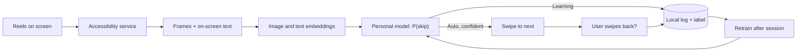

# auto_doomscroller

**An on-device model that learns which Reels you'd skip, and skips them for you.**

auto_doomscroller watches *how* you scroll: which reels you swipe past in a second, which
ones you watch to the end, which ones you like. From that it learns your taste, and in Auto
mode it swipes past the reels you would have skipped anyway.

It doesn't try to work out *why* you watch something. Funny clips, cats, cooking, whatever:
it only predicts one thing, **will you skip this reel?**

> Status: early development. Android app for Instagram Reels first, then a browser
> extension.

## How it works

1. **Learning mode.** Watch Reels as usual. For every reel the app records how long you
   stayed, whether it looped or you liked it, a few frames from its first second, and the
   on-screen text (creator, caption, audio).
2. **Personal model.** Frames and text are turned into embeddings on the device, and a
   small per-user model learns `P(skip)` from your own behaviour.
3. **Auto mode.** When a new reel starts, the app decides within about 1.5 s. If it is
   confident you'd skip it, it swipes to the next one.
4. **Corrections.** Swipe back to a reel it skipped and that counts as "should have
   watched". It learns from that too, so it improves the more you use it.



### What counts as skip or watch

| Label | Rule (initial thresholds) |
|---|---|
| `SKIP` | Swiped to the next reel within 2 s |
| `WATCH` | Looped, liked, or stayed 20 s or more |
| no label | Anything in between. Too ambiguous to learn from |

Details: [docs/data-format.md](docs/data-format.md).

### Being wrong as little as possible

Auto mode only acts when the model is confident. The threshold is picked so that at least
90% of auto skips are reels you really would have skipped. The main metric is therefore
**coverage at 90% precision**: how many of your skips it can take over while staying
right.

## Privacy

- Everything runs on the device. Nothing is uploaded and there is no account or server.
- Raw video and audio are never stored. Thumbnails are kept only if you turn on research
  mode, and you can delete them, the log, or everything at any time.
- Only the screens of supported apps are read.
- It never likes, comments, follows or shares on your behalf. Auto mode only swipes.

## Performance

The frame encoder runs on every reel, on the critical path of the skip decision, so it is
built in several precisions and benchmarked on device. All variants are evaluated on the
same held-out days.

| Encoder variant | Size | Latency / frame | Decision p95 | Skip AUC | Coverage @ 90% precision |
|---|---|---|---|---|---|
| FP32 | – | – | – | – | – |
| FP16 | – | – | – | – | – |
| INT8 dynamic range | – | – | – | – | – |
| INT8 full integer | – | – | – | – | – |

Battery drain and device temperature over a 30-minute session are recorded alongside.

## Repository layout

```
android/   Android app (Kotlin, Jetpack Compose)
  app/src/main/java/com/autodoomscroller/
    service/     Accessibility service, screenshots, swipe gestures
    adapter/     Per-app readers (Instagram Reels) and the node-tree dumper
    tracking/    Reel lifecycle and the SKIP / WATCH labeler
    features/    Frame and text features
    model/       Per-user preference model
    autopilot/   Auto mode decisions, cooldown, undo detection
    data/        Room database and thumbnail store
    export/      JSONL export for offline analysis
    session/     Mode and session state
    ui/          Compose screens
ml/        Offline analysis, baselines, metrics, encoder quantization (Python)
web/       Browser extension (planned)
docs/      Data format
```

## Getting started

### Android app

Requirements: Android Studio, a phone running Android 11 or later (Android 14+
recommended), USB debugging enabled.

1. Open `android/` in Android Studio and run the `app` configuration on your phone.
2. On the phone: **Settings → Accessibility → auto_doomscroller → On**.
3. In the app, pick **Learning** and go watch Reels.
4. Tap **Export** and pull the data:

   ```bash
   adb pull /sdcard/Android/data/com.autodoomscroller/files/exports ./data/
   ```

Debug builds log the accessibility node tree of the target app under the `NodeTree` tag
(`adb logcat -s NodeTree`), which is what the per-app adapters are written against.

Unit tests: `./gradlew testDebugUnitTest` from `android/`.

### ML

```bash
cd ml
uv venv && uv pip install -e ".[dev]"
pytest
```

See [ml/README.md](ml/README.md) for the analysis loop and the quantization script.

## Roadmap

- [ ] Reel logger for Instagram Reels (transitions, dwell, likes, frames, text)
- [ ] Offline baselines and first personal model
- [ ] On-device inference and live prediction overlay
- [ ] Auto mode with corrections
- [ ] Encoder quantization and on-device benchmarks
- [ ] Taste map, session report card
- [ ] YouTube Shorts
- [ ] Browser extension

## Disclaimer

Not affiliated with or endorsed by Instagram, Meta, YouTube or Google. The app uses
Android's accessibility APIs to read the screen and perform swipes, and is intended for
personal use.

## Acknowledgments

This project is developed as a mini project for *Mobile Computing and Its Applications
(001)*, taught by Prof. Cui Minhao at Seoul National University (SNU), 2026-2 semester.
