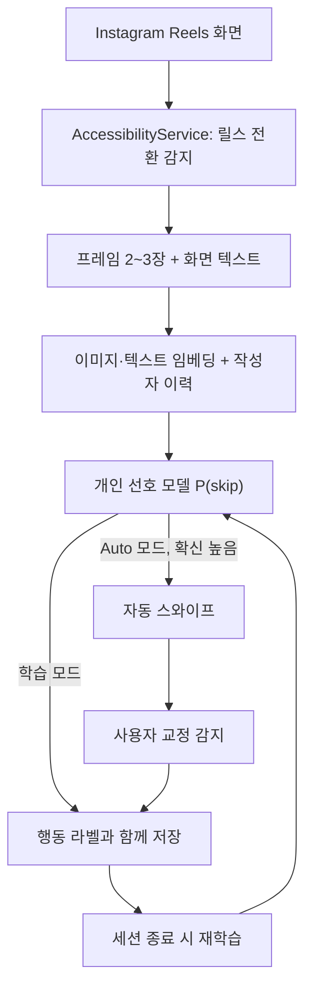

# auto_doomscroller 구현 명세서

**문서 버전:** 2.0  
**기준일:** 2026-10-18  
**이전 문서:** `AirScroll-Android-Spec.md` (제스처 리모컨안, 본 문서로 대체)

## 1. 한 줄 요약

사용자가 Instagram Reels를 보는 동안 **어떤 영상을 끝까지 보고 어떤 영상을 바로 넘기는지** 기기 안에서 학습하고, Auto 모드에서는 사용자가 넘길 것이 확실한 영상을 대신 넘겨 주는 Android 앱.

영상이 웃긴지, 왜 보는지는 판단하지 않는다. 고양이든 요리든 이유와 상관없이 **이 사용자가 이 영상을 넘길지**만 예측한다.

## 2. 범위

### 1단계 — 과제 (Android, 12월 중순까지)

**포함**

- 대상 앱: Instagram Reels 1개. YouTube Shorts는 일정 여유가 있을 때 추가한다.
- 학습 모드: 릴스별 화면 프레임 일부, 화면 텍스트, 체류·좋아요·넘기기 행동 기록
- 개인 선호 모델: 넘김 확률 `P(skip)` 예측, 기기 안에서 학습·갱신
- Auto 모드: 확신이 높을 때만 자동으로 넘기고, 사용자 교정을 학습에 반영
- 임베딩 모델 양자화 전후 비교 (정확도·지연·크기·배터리)
- 시각화: 실시간 디버그 오버레이, 취향 지도, 세션 리포트 카드, 최적화 비교 차트

**제외**

- 자동 좋아요·공유·팔로우. 계정에 공개되는 동작이고 플랫폼 추천 알고리즘에 영향을 주므로 하지 않는다.
- 서버, 계정 로그인, 비공식 API
- 여러 사용자의 데이터를 합친 공용 모델
- iOS
- 카메라 제스처 (선택 과제로 보류)

### 2단계 — 출시 (과제 이후)

- 데스크톱 브라우저 확장 (Chrome 우선): `youtube.com/shorts`, `instagram.com/reels` (13절)
- Google Play 배포판: 정책 때문에 Auto 모드 대신 **추천 모드**를 둔다. 클론이 넘길지 제안하고 사용자가 확정한다.
- 세션 리포트 카드 공유 기능

## 3. 핵심 정의: 라벨

모델이 맞힐 정답은 릴스 하나당 아래 셋 중 하나다. 수치는 **초기값**이며, 1주차 데이터의 체류시간 분포를 보고 조정한다.

| 라벨 | 조건 (초기값) | 의미 |
|---|---|---|
| `SKIP` | 체류 2.0초 미만에서 다음 영상으로 이동 | 첫인상만 보고 넘김 |
| `WATCH` | 루프 재생 감지, 좋아요, 체류 20초 이상 중 하나 | 끝까지 보거나 다시 봄 |
| 제외 | 그 외 (2~20초 사이에 넘김, 앱 이탈, 화면 꺼짐) | 판단이 애매하므로 학습에서 뺀다 |

- **끝까지 봤는지 판단:** Instagram은 영상 길이를 직접 알려주지 않는다. 화면 프레임 임베딩이 해당 릴스의 첫 프레임과 다시 비슷해지면 루프 재생으로 본다. 접근성 노드에 진행률 정보(`RangeInfo`)가 있으면 그것을 먼저 쓴다.
- **Auto 모드 중 라벨:**
  - 자동으로 넘긴 영상은 사용자가 보지 않았으므로 라벨을 만들지 않는다.
  - 자동으로 넘긴 직후 사용자가 이전 영상으로 돌아가면 **잘못 넘김**으로 기록한다. 이 영상은 `WATCH`로 학습하고 가중치를 높인다.
  - 클론이 넘기지 않은 영상을 사용자가 2초 안에 직접 넘기면 **놓친 넘김**이다. 일반 `SKIP`으로 학습한다.

## 4. 사용자 흐름

1. 설치 후 설명 화면에서 접근성 서비스가 왜 필요한지, 무엇을 저장하는지 안내한다. 이후 사용자가 설정에서 서비스를 켠다.
2. **학습 모드:** 사용자가 앱이나 알림에서 기록을 시작하고, 평소처럼 Reels를 본다. 기록 중에는 상태 알림을 띄운다. 라벨이 붙은 릴스가 300개를 넘고 검증 성능 목표(7절)를 넘으면 Auto 모드를 쓸 수 있다고 알린다.
3. **Auto 모드:** 새 릴스가 시작되면 1.5초 안에 판단한다. `P(skip)`이 임계값 이상이면 화면에 짧게 "넘김" 표시를 띄우고 위로 스와이프한다.
4. **교정:** 사용자는 이전 영상으로 돌아가는 것만으로 잘못 넘긴 것을 알려 준다. 별도 버튼은 필요 없다.
5. **리포트:** 세션이 끝나면 본 릴스 수, 자동으로 넘긴 수, 추정 절약 시간, 많이 본 유형을 보여 준다.
6. 사용자는 기록, 썸네일, 학습된 모델을 언제든 각각 삭제할 수 있다.

## 5. 구현 기준

| 항목 | 결정 |
|---|---|
| 언어·UI | Kotlin, Jetpack Compose (코드 작성은 AI 보조) |
| 앱 감지·제어 | `AccessibilityService`: 대상 패키지 감지, 릴스 전환과 좋아요 상태 읽기, `dispatchGesture()`로 스와이프, 접근성 오버레이로 상태 표시 |
| 화면 프레임 | `AccessibilityService.takeScreenshot()` (Android 11+, `canTakeScreenshot` 선언). 호출 간격 제한이 있으므로 릴스당 2~3장만 찍는다 (시작 후 약 0.3, 0.8, 1.3초). 실기기에서 최소 간격을 측정한다. 쓸 수 없으면 MediaProjection으로 대체한다 |
| 이미지 특징 | MediaPipe Image Embedder (MobileNetV3)를 기본으로 한다. 비교 후보는 MobileCLIP 등 CLIP 계열 소형 모델 (라이선스 확인 필요) |
| 화면 텍스트 | 작성자, 캡션, 음원명은 접근성 노드 텍스트를 먼저 쓴다. 영상 위에 박힌 자막은 ML Kit 텍스트 인식(한국어)으로 읽는다 |
| 텍스트 특징 | 다국어 소형 문장 임베딩 모델을 LiteRT로 변환해 쓴다. 변환이 막히면 해시 n-gram 특징으로 대체한다 |
| 개인 모델 | 로지스틱 회귀 또는 소형 MLP를 Kotlin에서 직접 학습한다 (세션 종료 시 재학습). 비교용으로 kNN을 둔다 |
| 저장 | Room. 연구 모드에서만 224px 썸네일 저장 (8절) |
| 분석·실험 | Python (Colab): 내보낸 로그로 오프라인 평가, 양자화, LiteRT 변환 |
| 테스트 단말 | 본인 Android 휴대전화. Android 11 이상 필수, 14 이상 권장 |

## 6. 시스템 구성

### 모듈 책임

| 모듈 | 책임 |
|---|---|
| `MainActivity` / Compose 화면 | 홈, 모드 전환, 리포트, 취향 지도, 설정, 데이터 삭제·내보내기 |
| `ReelsAccessibilityService` | 패키지 필터, 이벤트 수신, 스크린샷, 제스처 실행, 오버레이 |
| `InstagramReelsAdapter` | 릴스 전환 판정, 작성자·캡션·음원·좋아요 상태 추출. 노드 구조는 실기기에서 덤프해 확정한다 |
| `ReelTracker` | 릴스 단위 기록: 시작·종료 시각, 프레임, 루프 감지, 라벨 결정 |
| `FeatureExtractor` | 이미지·텍스트 임베딩, 작성자 이력 특징 |
| `PreferenceModel` | 예측, 재학습, 임계값 관리 |
| `AutoPilot` | Auto 모드 판단과 실행, 교정 처리, 쿨다운. 자기가 보낸 스와이프와 사용자 스와이프를 구분한다 |
| `ReelRepository` | Room 저장소 |
| `Exporter` | 연구용 내보내기. 사용자가 직접 실행한다 |

### 릴스 전환 판정

Instagram은 화면 구조가 자주 바뀌므로 신호 하나에 의존하지 않는다. 아래 셋 중 **두 개 이상이 일치하면** 새 릴스로 판정한다.

1. 릴스 목록의 스크롤 이벤트
2. 작성자·캡션 노드 텍스트 변화
3. 프레임 임베딩의 급격한 변화

릴스 식별자는 `작성자 + 캡션 해시 + 첫 프레임 임베딩 해시`로 만든다. 노드를 찾지 못한 릴스는 추정하지 않고 기록에서 제외한다.

## 7. 특징과 모델

### 릴스별 입력 특징

| 특징 | 내용 |
|---|---|
| 이미지 임베딩 | 프레임 2~3장의 평균 |
| 텍스트 임베딩 | 캡션 + 해시태그 + 음원명 + 영상 자막 |
| 작성자 이력 | 이 작성자 영상의 과거 `WATCH` 비율(스무딩 적용), 본 횟수 |
| 맥락 (선택) | 시간대, 세션 시작 후 경과 시간 |

### 예측과 판단

- 출력은 `P(skip)` 하나다.
- **판단 시한:** 릴스 시작 후 1.5초 이내. 첫 프레임만으로 확신이 높으면 더 일찍 판단해도 된다.
- **Auto 임계값:** 검증 데이터에서 **정밀도 90% 이상**이 되는 값으로 정한다 (초기 목표). 틀리게 넘기는 일을 최소화하고, 확실한 영상만 넘기는 것이 원칙이다.
- **콜드 스타트:** 라벨이 붙은 릴스가 300개 미만이거나 검증 정밀도 목표에 못 미치면 Auto 모드를 비활성화한다.
- 모델은 사용자마다 따로 두고, 데이터는 기기 밖으로 나가지 않는다.

## 8. 데이터 수집과 개인정보

- 원본 영상과 오디오는 저장하지 않는다.
- **연구 모드** (기본 꺼짐, 본인 기기·본인 데이터 한정): 프레임을 224px 썸네일로 저장한다. 양자화 전후 모델을 **같은 데이터로** 다시 임베딩해 비교하려면 반드시 필요하다. 과제가 끝나면 삭제한다.
- **출시판:** 임베딩과 텍스트 특징만 저장한다.
- **내보내기:** 사용자가 직접 실행한다. Room 데이터를 CSV 또는 Parquet로, 썸네일은 zip으로 내보낸다.
- **목표 데이터량:** 사람당 최소 1주, 릴스 1,000개 이상.
- **분할:** 날짜 기준으로 나눈다 (앞 날짜로 학습, 뒤 날짜로 테스트). 무작위 분할은 같은 날·같은 작성자 영상이 학습과 테스트에 섞여 성능이 부풀려지므로 쓰지 않는다.
- **팀원이 있으면:** 각자 개인 모델을 만들고, 남의 모델로 내 취향을 예측하는 교차 실험을 한다. 개인화가 실제로 효과가 있는지 보여 주는 좋은 실험이다.

## 9. 모델 최적화 실험 (과제 필수 항목)

**대상:** 이미지 임베딩 인코더 (가능하면 텍스트 인코더도). 릴스마다 실행되고 판단 시한(1.5초) 안에 끝나야 하므로, 지연이 사용자가 직접 느끼는 품질로 이어진다.

**변형:** FP32, FP16, INT8 동적 범위, INT8 전체 정수 (보정용 대표 데이터는 수집한 썸네일).

**Pruning 대신 Quantization을 고른 이유:** 비구조적 가지치기는 파일 크기는 줄이지만, 희소 연산 커널이 없는 모바일 CPU에서는 지연이 거의 줄지 않는다.

| 지표 | 측정 방법 |
|---|---|
| 판단 지연 | 릴스 시작부터 `P(skip)` 산출까지, p50·p95, 실기기 |
| 인코더 추론 지연 | 프레임당 ms, CPU·GPU delegate별 |
| 모델 크기 | MB |
| 배터리·발열 | 30분 세션 전후의 배터리 %, 기기 온도 |
| 예측 성능 | 넘김 예측 AUC, 정밀도 90%일 때의 커버리지 |

모든 변형은 **같은 테스트 분할**에서 비교한다.

## 10. 평가

### 오프라인 비교 (특징별 기여도)

| # | 모델 | 목적 |
|---|---|---|
| 1 | 항상 "안 넘김" | 최저 기준선 |
| 2 | 작성자 이력만 | 단순 규칙으로 어디까지 되는지 |
| 3 | 텍스트 특징만 | |
| 4 | 이미지 특징만 | |
| 5 | 전체 특징 | 제안 모델 |

### 실사용 평가

Auto 모드 실사용 세션에서 자동으로 넘긴 횟수, 교정 비율(되돌아간 비율), 추정 절약 시간을 기록한다.

### 목표치

아래는 **프로젝트 목표**이며 사전에 보장된 성능이 아니다. 한 명(또는 두 명)의 사용자, 한 기기 기준이다.

| 지표 | 목표 |
|---|---|
| 넘김 예측 AUC | 0.70 이상 |
| 정밀도 90%일 때 커버리지 | 넘긴 영상의 25% 이상 |
| Auto 모드 교정 비율 | 10% 이하 |
| 판단 지연 | p95 1.5초 이내 |
| 안정성 | 30분 세션 동안 크래시·서비스 중단 0회 |
| 안전 동작 | 대상 앱이 아닐 때 동작 0회, 자동 좋아요 0회, 네트워크 업로드 0회 |

## 11. 시각화 (과제 필수 항목 겸 바이럴 기능)

1. **실시간 디버그 오버레이:** 현재 릴스의 `P(skip)`, 판단까지 걸린 시간, 확정된 라벨
2. **취향 지도:** 임베딩을 2D로 투영(기기에서는 PCA, 오프라인에서는 UMAP)하고 `WATCH`·`SKIP`을 색으로 표시한다. 군집마다 대표 썸네일과 키워드를 붙인다.
3. **세션 리포트 카드:** 본 릴스 수, 자동으로 넘긴 수, 아낀 시간, 많이 본 유형. 이미지로 저장·공유할 수 있게 한다.
4. **최적화 비교 차트:** 9절 변형별 지연·정확도·크기
5. **학습 곡선:** 데이터 개수에 따른 AUC. 쓸수록 정확해진다는 것을 보여 준다.

## 12. 일정 (2026-10-19 시작, 8주)

| 주 | 기간 | 결과물 | 완료 조건 |
|---|---|---|---|
| 1 | 10/19–10/25 | 기록 앱 최소 버전: 릴스 전환, 체류, 좋아요, 스크린샷, 썸네일 저장 | 하루치 실사용 로그가 정상 저장됨. **이날부터 수집 시작** |
| 2 | 10/26–11/1 | 텍스트 추출, 루프 감지, 안정화, 내보내기. 제안서 초안 | 라벨 분포 그래프 확인 |
| 3 | 11/2–11/8 | 제안서 제출. Colab에서 첫 오프라인 실험 | **판단 지점:** AUC가 우연 수준(약 0.5)이면 특징과 라벨 정의를 재검토 |
| 4 | 11/9–11/15 | 개인 모델 Kotlin 이식, 실시간 예측 오버레이 | 학습 모드에서 예측값이 실시간으로 표시됨 |
| 5 | 11/16–11/22 | Auto 모드, 교정 처리 | 실사용에서 자동 넘김과 교정 기록이 동작함 |
| 6 | 11/23–11/29 | 양자화 실험, 실기기 측정 | 9절 표 완성 |
| 7 | 11/30–12/6 | 취향 지도, 리포트 카드. 여유가 있으면 YouTube Shorts | 11절 화면 동작 |
| 8 | 12/7–12/13 | Auto 모드 실사용 평가, 논문, 시연 영상 | 10절 지표와 남은 한계를 보고서에 기록 |

제안서 마감일은 올해 날짜로 다시 확인한다. 강의 슬라이드의 "Nov 7 Sunday"는 2021년 달력이다.

## 13. 2단계: 브라우저 확장 (과제 이후)

- **형태:** Chrome 확장 (Manifest V3). 콘텐츠 스크립트가 페이지에서 작성자, 캡션, 좋아요 상태를 텍스트로 바로 읽는다. OCR이 필요 없다.
- **정확한 시청 비율:** `<video>` 요소의 `duration`과 `currentTime`으로 계산한다. Android보다 라벨 품질이 좋다.
- **프레임:** 영상을 canvas에 그리면 출처가 다른 영상이라 픽셀을 읽지 못할 수 있다. `chrome.tabs.captureVisibleTab`으로 화면을 캡처한다.
- **모델:** Python 학습 결과를 ONNX 또는 TF.js로 변환하고, ONNX Runtime Web이나 MediaPipe Tasks Web으로 실행한다. Android와 같은 특징 정의를 써서 모델 구조를 재사용한다.
- **Next.js:** 랜딩 페이지와 대기자 명단.

## 14. 주요 리스크와 대응

- **Instagram UI 변경:** 앱별 어댑터로 분리한다. 노드를 못 찾으면 그 릴스는 기록에서 제외하고 추정하지 않는다.
- **스크린샷 간격 제한·실패:** 릴스당 프레임 수를 줄인다. 그래도 안 되면 MediaProjection으로 대체한다.
- **라벨 잡음:** 애매한 구간은 학습에서 빼고, 임계값을 실제 분포에 맞춰 조정한다.
- **플랫폼 사전 필터링:** Instagram이 이미 취향에 맞춘 영상만 보여 주므로 AUC에 한계가 있다. 그래서 전체 AUC보다 정밀도 우선 운영점(정밀도 90%일 때 커버리지)을 핵심 지표로 삼는다.
- **데이터 부족:** 1주차부터 수집을 시작한다. 팀원이 있으면 데이터가 두 배가 된다.
- **Play 정책:** [Play 정책](https://support.google.com/googleplay/android-developer/answer/10964491)은 접근성 API로 앱이 자율적으로 행동을 시작·계획·실행하는 것을 금지한다. Auto 모드는 과제용 사이드로드 APK에만 두고, Play판은 추천 모드로 바꾼다.
- **플랫폼 약관:** 기기 안에서 개인적으로만 쓰고, 자동 좋아요나 팔로우 같은 계정 활동은 하지 않는다.
- **개인정보:** 썸네일은 연구 모드에서만 저장하고, 모든 데이터에 삭제 기능을 둔다.

## 15. 참고자료

**구현**

- [Android: AccessibilityService (takeScreenshot, dispatchGesture)](https://developer.android.com/reference/android/accessibilityservice/AccessibilityService)
- [Android: MediaProjection](https://developer.android.com/media/grow/media-projection)
- [Google AI Edge: MediaPipe Image Embedder (Android)](https://ai.google.dev/edge/mediapipe/solutions/vision/image_embedder/android)
- [Google ML Kit: 텍스트 인식 v2 (Android)](https://developers.google.com/ml-kit/vision/text-recognition/v2/android)
- [LiteRT: 학습 후 양자화](https://ai.google.dev/edge/litert/models/post_training_quantization)
- [Chrome Extensions: tabs.captureVisibleTab](https://developer.chrome.com/docs/extensions/reference/api/tabs#method-captureVisibleTab)
- [Google Play: AccessibilityService API 정책](https://support.google.com/googleplay/android-developer/answer/10964491)

**관련 연구·제품 (제안서 선행연구용)**

- [BlinkScroll](https://play.google.com/store/apps/details?id=com.app.blinkscroll&hl=en_US), [EyeScroll](https://play.google.com/store/apps/details?id=io.eyescroll.app&hl=en): 얼굴·손 제스처로 넘기는 앱. 사용자가 직접 명령해야 한다. 본 프로젝트는 행동을 학습해 스스로 판단한다는 점이 다르다.
- [Google Project Gameface (Android)](https://developers.googleblog.com/en/project-gameface-launches-on-android/): MediaPipe와 접근성 서비스를 조합한 오픈소스
